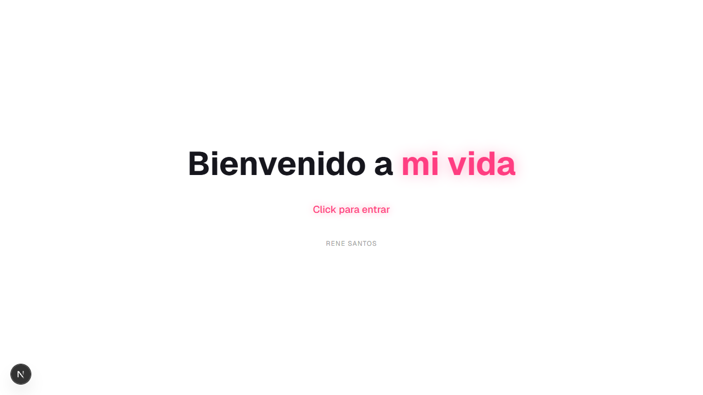
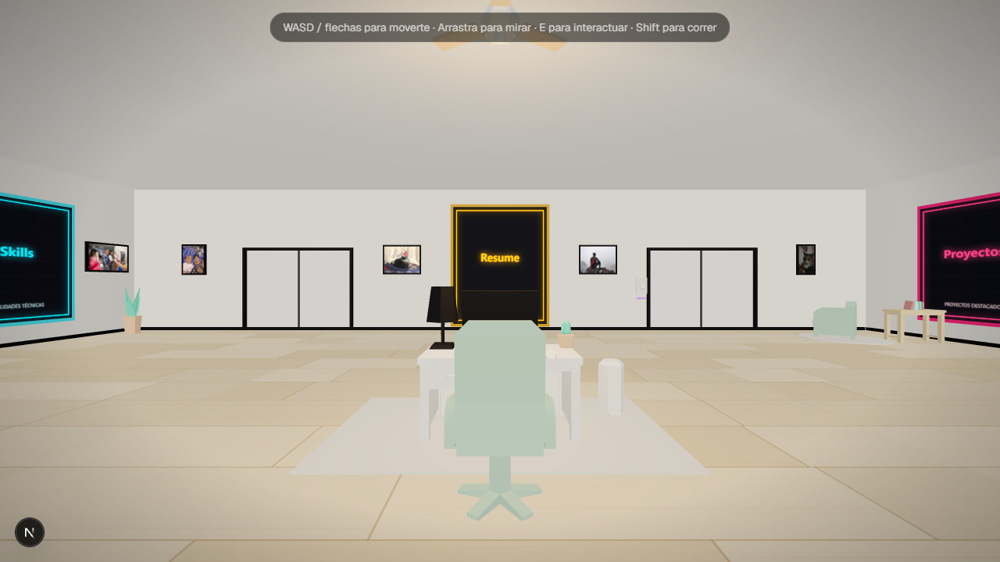
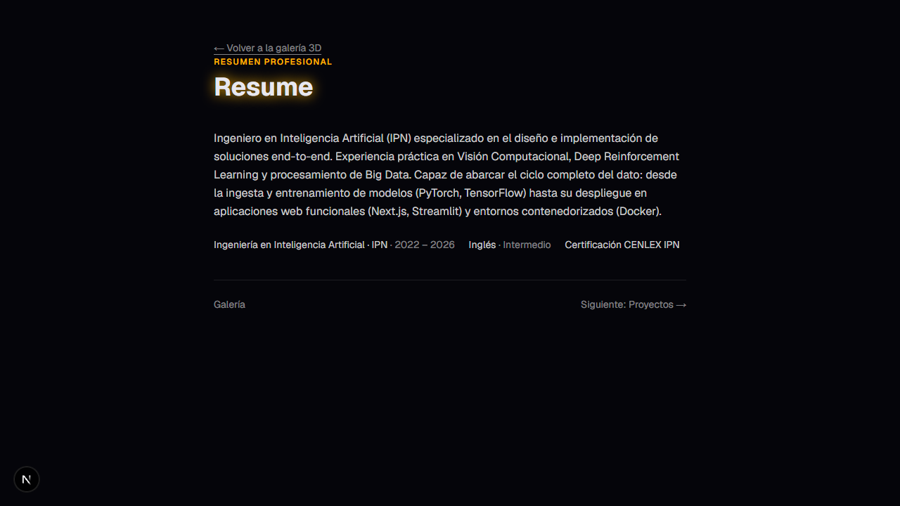
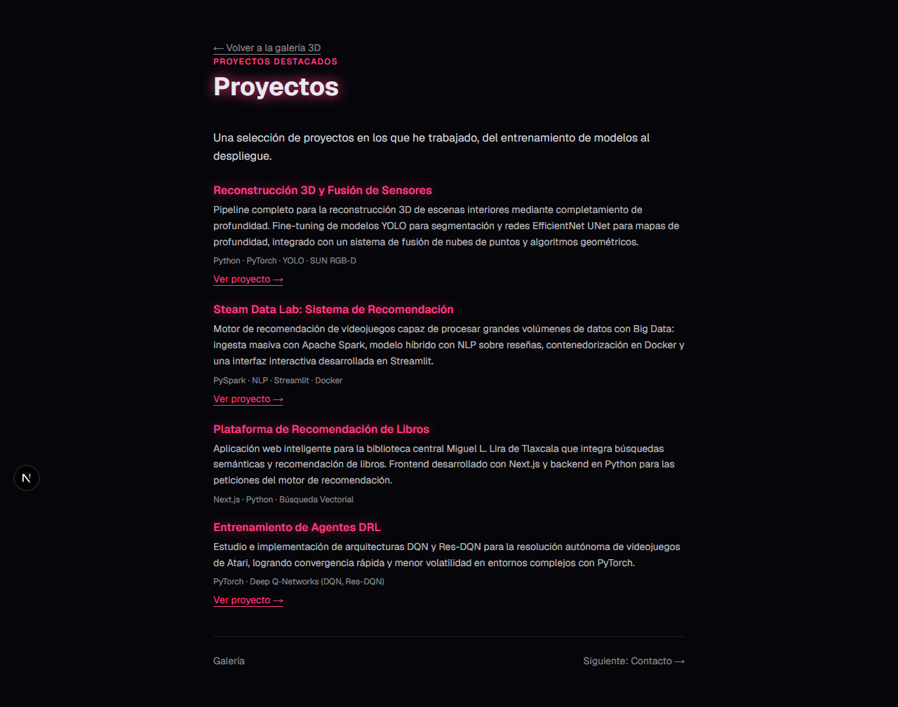

# Galería Neón — Portafolio 3D de Rene Santos

Portafolio web interactivo: una **galería de arte en 3D** con estilo neón donde cada cuadro de la habitación es una sección del CV. Recorre el espacio como un videojuego, acércate a los cuadros para descubrir proyectos, habilidades y cómo contactar.

> Nombre del proyecto: `neon-portfolio` · Basado en **Next.js (App Router, export estático)** + **Three.js**.

## Capturas

| Intro "Bienvenido a mi vida" | La galería |
| --- | --- |
|  |  |
| **Sección Resume (cuadro central)** | **Sección de proyectos** |
|  |  |

## Características

- **Intro animada**: pantalla de bienvenida con "Bienvenido a mi vida"; al hacer click en cualquier parte, el fondo blanco se abre como cortinas revelando la habitación (se muestra en cada carga/recarga).
- **5 cuadros de sección** con glow neón:
  - `Resume` (centro de la pared del fondo, más grande que los demás).
  - `Skills` y `Habilidades sociales` (pared izquierda).
  - `Proyectos` y `Contacto` (pared derecha).
- **Fotos en las paredes**: 8 cuadros decorativos (7 fotos personales y el escudo del IPN), con marcos oscuros y proporción automática respecto a la imagen.
- **Modo obscuro**: interruptor físico en la pared del fondo (junto a la ventana trasera). Al presionarlo la habitación se apaga con fade + parpadeo tipo fluorescente; las luces y la exposición bajan, pero los cuadros de sección conservan su glow neón.
- **Panel de sección**: al abrir un cuadro, la cámara vuela hasta él y se muestra el contenido con descripciones, tecnologías y enlaces a los repos.
- **Adaptativo**: detecta la GPU (`detect-gpu`) y ajusta la calidad; en móvil aparece un joystick táctil. Fallback estático si no hay WebGL.

## Stack

| Área | Tecnología |
| --- | --- |
| Framework | Next.js 16 (App Router, Turbopack, `output: "export"`) |
| UI | React 19, TypeScript, Tailwind CSS 4 |
| 3D | Three.js, @react-three/fiber, @react-three/drei |
| Animación | gsap |

## Empezar

Requiere **Node 20+**.

```bash
npm install       # instalar dependencias
npm run dev       # desarrollo en http://localhost:3000
npm run build     # build de producción (export estático en out/)
npm run start     # servir el build
npm run lint      # eslint
npm run deploy    # desplegar out/ a Cloudflare Pages (wrangler)
```

## Controles

| Acción | Teclado / Mouse | Móvil |
| --- | --- | --- |
| Movimiento | `WASD` / flechas | Joystick táctil (izquierda) |
| Correr | `Shift` | — |
| Mirar | Arrastrar con el mouse | Arrastrar en pantalla |
| Abrir sección | `E` cerca de un cuadro, o click directo | Tap en el cuadro |
| Cerrar panel | `Esc`, click fuera o botón "Cerrar" | Igual |

## Estructura

```
app/                  App Router (home + /sections/[id] estáticas por sección)
components/           Escena 3D y UI
  Experience.tsx      Canvas raíz, estado de la app e intro
  Player.tsx          Cámara con collisiones y controles
  Room.tsx            Habitación: paredes, ventanas, muebles, fotos e interruptor
  Paintings.tsx       Cuadros de sección (posición/orientación/tamaño)
  CameraDirector.tsx  Vuelos de cámara al abrir/cerrar secciones
  Lighting.tsx        Luces globales + modo obscuro (fade/parpadeo/exposición)
  LightSwitch.tsx     Interruptor 3D interactivo "MODO OBSCURO"
  IntroScreen.tsx     Intro "Bienvenido a mi vida" con apertura de cortinas
  ExperienceLoader.tsx Carga diferida + fallback sin WebGL
content/
  sections.ts         ★ Contenido de todas las secciones (edita aquí)
lib/
  level.ts            Geometría de la sala y posiciones (PAINTING_SPOTS)
  collisions.ts       Cajas de colisión
  input.ts            Estado global de entrada (teclado/joystick/cámara)
  roomLight.ts        Estado global del modo obscuro
  paintingTexture.ts  Texturas canvas (cuadros, etiquetas)
  quality.ts, floorTexture.ts
public/
  models/             Modelos .glb del mobiliario
  photos/             photo-1 … photo-8 (cuadros decorativos)
```

## Editar el contenido

Todo el contenido del CV vive en **`content/sections.ts`**: títulos, subtítulos, colores de cada sección, habilidades (con niveles), proyectos (nombre, descripción, tecnologías y link al repo en GitHub) y canales de contacto (email, GitHub, LinkedIn).

Posiciones de los cuadros en la habitación: `lib/level.ts` → `PAINTING_SPOTS` (coordenadas + rotación; el cuadro `resume` admite tamaño propio en `components/Paintings.tsx`).

Fotos de las paredes: copia tus imágenes a `public/photos/` y agrega/regístralas en el arreglo de `components/Room.tsx` (`WallPhoto` calcula el marco según la proporción de la imagen; `scale` opcional).

## Despliegue

El proyecto exporta un **sitio estático**:

- `npm run build` genera `out/`.
- **Cloudflare Pages**: `npm run deploy` (requiere `wrangler` autenticado), o conecta el repo en el dashboard de Cloudflare.
- **Vercel**: importar el repo y desplegar tal cual (Vercel respeta el export estático).

## Autor

Rene Alejandro Santos Mora — Ingeniero en Inteligencia Artificial (IPN)

- GitHub: [github.com/PHDRENIS](https://github.com/PHDRENIS)
- LinkedIn: [rene-alejandro-santos-mora](https://www.linkedin.com/in/rene-alejandro-santos-mora-a35902357/)
- Email: [renealejanso@gmail.com](mailto:renealejanso@gmail.com)
